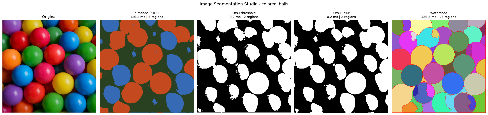

# Image Segmentation Studio

Runs K-means, Otsu thresholding and watershed segmentation on the same images, then compares their results and speed side by side.



## Setup

Run these from the `image_segmentation_studio/` folder:

```bash
python3 -m venv .venv
```

```bash
source .venv/bin/activate
```

```bash
pip install -r requirements.txt
```

## Usage

| Command | What it does |
|---|---|
| `python demo.py --no-show` | Processes every image in `tests/test_images/` and saves the results |
| `python demo.py --image tests/test_images/apple.jpg` | Processes one image and opens the comparison window |
| `python demo.py --synthetic --no-show` | Uses a generated image, so no files are needed |
| `python demo_thresholding.py` | Compares Otsu, Otsu with blur and manual thresholding |
| `python -m pytest tests -q` | Runs all tests |

By default, results are saved to `results/` at the repository root: one folder per image, plus `performance.csv` and `performance.md`.

## Results

Mean time across the three test images, from one run on one laptop:

| Method | Mean time |
|---|---|
| Otsu | 0.40 ms |
| Otsu + blur | 0.37 ms |
| K-means (K=3) | 143.29 ms |
| Watershed | 358.20 ms |

No method was best on every image. See the [full report](docs/report_draft.md).

## Project structure

| Path | Purpose |
|---|---|
| `src/kmeans_segmentation.py` | K-means clustering |
| `src/thresholding_segmentation.py` | Otsu and manual thresholding |
| `src/watershed_segmentation.py` | Marker-based watershed |
| `src/segmentation_studio.py` | Runs, times, displays and compares all methods |
| `src/utils.py` | Shared interface, image helpers, timing and mocks |
| `demo.py` | Command-line demo |
| `tests/` | Automated tests and shared test images |
| `docs/` | Report, demo script and contribution table |

## Adding or replacing a method

Each method must take a BGR image and return a result of the same height and width. The result can be a BGR image, a `uint8` mask or an `int32` label map.

The studio finds methods by function name, using the list in `METHOD_SPECS` in `src/segmentation_studio.py`. For example, replacing the watershed module only requires a function called `segment_watershed(image)` in `src/watershed_segmentation.py`.

If a method can't be found, the studio uses a mock and labels it `MOCK`, so check the status line at the start of each run.
