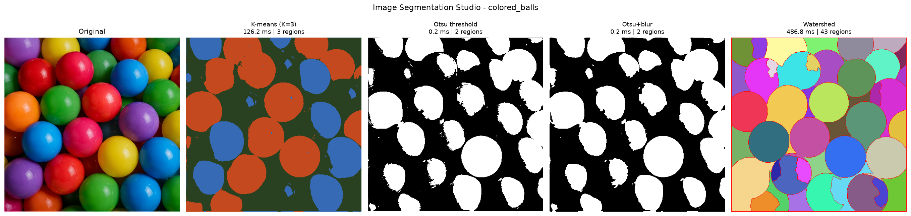
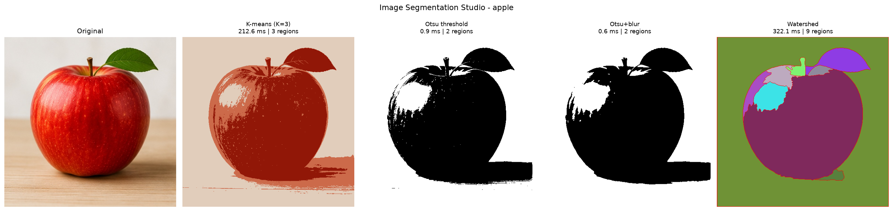
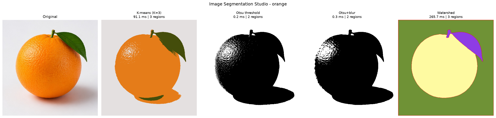

# Image Segmentation Studio: Project Report

## 1. Introduction

Image segmentation divides an image into meaningful regions. It is a common first step in tasks such as object recognition, medical imaging and industrial inspection.

This project implements three classical segmentation methods, K-means clustering, Otsu thresholding and watershed, and runs them through one shared application. Each method is applied to the same images so that its output and running time can be compared directly.

## 2. Test Images

Three images are used by every method:

| Image | Size (pixels) | Why it is useful |
|---|---|---|
| Apple | 505 x 501 | Single object with skin streaks, a highlight, a leaf and a shadow |
| Orange | 498 x 501 | Single object with rough texture, a leaf and a soft shadow on a plain background |
| Coloured balls | 505 x 502 | Many touching objects in many colours, with bright highlights |

## 3. K-means Segmentation

### 3.1 Method

K-means treats every pixel as a point in colour space and groups the pixels into K clusters:

1. Choose K starting cluster centres.
2. Assign each pixel to its nearest centre.
3. Move each centre to the mean colour of its pixels.
4. Repeat steps 2 and 3 until the centres stop changing.

Each pixel is then replaced by the colour of its cluster centre.

### 3.2 Implementation

The implementation uses OpenCV's `cv2.kmeans` with K = 3, k-means++ initialisation and 5 attempts. It stops after 100 iterations or when the centres move by less than 0.2.

### 3.3 Results

- **Apple:** the background is separated well, but the green leaf falls into the same cluster as the red apple body, and the highlight separates from the rest of the apple.
- **Orange:** the fruit, leaf and background are all identified, but the orange-tinted shadow joins the fruit's cluster and part of the darker shadow joins the leaf's cluster.
- **Coloured balls:** three clusters cannot represent all the ball colours, so warm colours such as red, orange and yellow merge together.

### 3.4 Limitations

K must be chosen in advance. Position is ignored, so separate objects of similar colour share one cluster and K-means cannot count objects. The random initialisation can also change the result slightly between runs.

## 4. Thresholding Segmentation

### 4.1 Introduction

Thresholding is an image segmentation technique that separates an image into regions based on pixel intensity. It converts a grayscale image into a binary image, where pixels are classified as foreground or background.

In this project, Otsu's automatic thresholding is implemented and compared with manual thresholding. Gaussian blur is also applied as a preprocessing technique to investigate its effect on segmentation quality.

### 4.2 Theoretical Background

A grayscale image contains pixel intensity values ranging from 0 to 255. Thresholding uses a threshold value T to classify each pixel:

- If the pixel intensity is greater than T, it is assigned 255 (white).
- Otherwise, it is assigned 0 (black).

Otsu's method automatically determines a threshold by analysing the grayscale image histogram. It selects the threshold that maximises the between-class variance of the foreground and background classes. This is equivalent to minimising their weighted within-class variance.

Manual thresholding uses a threshold selected by the user. In this project, a threshold of 127 is used as a baseline for comparison.

### 4.3 Gaussian Blur Preprocessing

Gaussian blur is applied before thresholding to reduce noise and small intensity variations. This can make the segmentation more stable.

However, excessive blurring may remove small details and soften object boundaries. Therefore, the results with and without Gaussian blur are compared.

### 4.4 Implementation

The thresholding module implements three methods:

1. Otsu thresholding without preprocessing.
2. Otsu thresholding after Gaussian blur (5 x 5 kernel).
3. Manual thresholding using a fixed threshold of 127.

The implementation uses Python, OpenCV and NumPy. The input images are converted to grayscale before thresholding.

### 4.5 Experimental Design

The same three images used by the other project members are used for testing: apple, coloured balls and orange.

Each image is processed using the three configurations:

- Otsu without Gaussian blur.
- Otsu with Gaussian blur.
- Manual thresholding with T = 127.

This produces nine segmentation outputs in total.

### 4.6 Results and Discussion

| Image | Otsu T | Otsu T with blur | Pixels changed by blur | Pixels that differ between Otsu and T = 127 |
|---|---|---|---|---|
| Apple | 136 | 136 | 0.80% | 1.38% |
| Coloured balls | 87 | 87 | 1.38% | 29.53% |
| Orange | 180 | 180 | 1.34% | 31.51% |

- **Automatic and manual thresholds:** Otsu chose a very different threshold for each image. The fixed value of 127 happened to be close for the apple (136), so the outputs nearly match. It was far from the best value for the balls (87) and the orange (180), where about 30% of the pixels change class.
- **Gaussian blur:** blur did not change the selected threshold on any image, and changed only 0.80% to 1.38% of the pixels. Its visible effect is local: boundaries are smoother and there are fewer isolated specks, most clearly in the orange's textured skin.
- **Object separation:** the apple and the orange are mostly separated from a bright background, but each fruit's shadow joins it in the foreground, and bright highlights are lost to the background.
- **Coloured balls:** Otsu separates brighter balls from darker ones according to grayscale brightness rather than by object. Dark balls and the gaps between balls fall into the same class.

### 4.7 Limitations

Thresholding relies on grayscale intensity differences. If the foreground and background have similar grayscale intensities, they may not be separated correctly.

Otsu's method works best when the image histogram contains reasonably distinct intensity groups. Gaussian blur can reduce noise but may also remove fine details.

### 4.8 Conclusion

Otsu's method provides an automatic way to select a threshold without requiring the user to choose one manually. Comparing it with a fixed manual threshold helps demonstrate the advantages and limitations of automatic threshold selection.

The Gaussian blur experiment shows how preprocessing can influence the final segmentation result. The most suitable method depends on the image and the intensity differences between its foreground and background.

## 5. Watershed Segmentation

### 5.1 Method

Watershed treats the image as a landscape in which strong edges form ridges. Water rises from a set of starting points called markers. Where water from two different markers meets, a boundary is drawn. Without good markers, watershed produces far too many regions, so choosing the markers is the main design decision.

### 5.2 Implementation

1. **Smooth the image** with mean-shift filtering and a median filter. This flattens texture and small highlights but keeps object edges.
2. **Find edges** from the Sobel gradient in Lab colour space. Otsu's method selects the edge threshold automatically. Using colour means that edges between colours of similar brightness are still found.
3. **Compute a distance transform,** giving each pixel its distance to the nearest edge. Region centres become peaks.
4. **Create markers** from pixels close to their local peak, then label each connected group.
5. **Flood** with `cv2.watershed`.
6. **Remove regions smaller than 0.4% of the image,** such as highlights, and flood again from the remaining markers.

### 5.3 Why not the textbook version?

The common textbook recipe finds markers from an Otsu foreground mask. It was tested first and rejected for these images. On the apple it produced 2 regions, with the shadow joined to the fruit. On the coloured balls it produced 25 regions, because dark balls were treated as background and a single brightness threshold cannot describe the image.

### 5.4 Results

- **Orange:** 3 clean regions: background, fruit and leaf with stem. This is the clearest result of any method on this image, and the shadow stays in the background.
- **Apple:** 9 regions. The leaf, stem and main body are separated, and the background and table form one region. The upper-left of the apple is split into extra regions by its highlight and streaks, which is over-segmentation.
- **Coloured balls:** 43 regions. Most balls receive their own region, including touching balls of the same colour, which K-means and Otsu cannot do. The count is not the number of balls, because gaps between balls form regions of their own and some balls are split by their highlights.

### 5.5 Limitations

- Objects that overlap heavily with no visible edge between them can merge. In a synthetic test, two identical discs overlapping by 15 pixels merged, while discs that only touched were separated.
- The parameters were chosen by comparing results on these three images, so they may need adjusting for other images.
- It is the slowest method tested, mainly because of mean-shift filtering.

## 6. System Integration

All methods run through one class, `ImageSegmentationStudio`.

**Shared interface.** Each method takes a BGR image and returns an image of the same height and width, in one of three forms: a BGR image, a binary mask or a label map. The studio converts each form into a displayable image. This let members develop their methods separately.

**Main features:**

- Each method is timed as the mean of 3 runs.
- Comparison figures show the original image and every method side by side.
- Performance tables are saved as CSV and Markdown.
- A whole folder of images can be processed with one command.
- A failure in one method is reported without stopping the others.
- Temporary mock methods allowed the system to be built before the algorithms were ready. Any mock output is labelled `[MOCK result]`, and no mock output is used in the final results.

**Browser interface.** A small Flask application lets a user choose an image or upload one, select a method and adjust its options in the browser, with the result updating each time. The options are K for K-means; Otsu or a manual threshold, plus Gaussian blur, for thresholding; and smoothing, marker strictness and smallest region for watershed. A compare mode shows all three methods side by side with their times and region counts. It runs locally and needs no internet connection.

## 7. Testing

The automated test suite has 53 tests, all passing. The dataset, expected behaviour and test cases are described in `docs/test_plan.md`. The tests cover:

- Every method returning output of the correct size on all three shared images.
- Every output being convertible to a displayable image.
- Watershed separating touching discs and rejecting invalid input.
- Otsu output being binary and K-means using K colours.
- The studio using only real methods, surviving a failing method and saving all expected files.
- The browser interface running every method, applying its options, and rejecting bad requests and files.

Accuracy was not measured numerically, because the images have no hand-labelled ground truth. Quality was judged by visual inspection, as described in each results section.

## 8. Comparison of Methods

Times are from one run of the studio on one Mac laptop, each averaged over 3 repeats, so they indicate relative speed rather than exact values. Differences under about 1 ms, such as Otsu with and without blur, are within measurement noise.

| Image | K-means (K=3) | Otsu | Otsu + blur | Watershed |
|---|---|---|---|---|
| Apple | 212.61 ms | 0.86 ms | 0.60 ms | 322.12 ms |
| Coloured balls | 126.20 ms | 0.16 ms | 0.21 ms | 486.76 ms |
| Orange | 91.07 ms | 0.19 ms | 0.29 ms | 265.71 ms |
| **Mean** | **143.29 ms** | **0.40 ms** | **0.37 ms** | **358.20 ms** |

| | K-means | Otsu | Watershed |
|---|---|---|---|
| **Uses** | Colour | Grayscale brightness | Edges and position |
| **Speed** | Medium | Fastest by far | Slowest |
| **Main input needed** | K | None (fully automatic) | Marker settings |
| **Separates touching objects** | No | No | Yes, when an edge is visible |
| **Main weakness** | Similar colours merge | Shadows and dark objects | Over-segmentation |
| **Best result here** | Reducing an image to main colours | Fast object and background separation on a plain background | Orange; separating the balls |

## 9. Conclusion

No method was best on every image. There is a clear trade-off between speed and detail. Otsu runs in under a millisecond but only sees brightness. K-means uses colour but ignores position. Watershed was the only method able to separate touching objects, but it was the slowest and tended to over-segment.

The choice therefore depends on the task: Otsu for fast separation on a plain background, K-means for grouping by colour, and watershed when individual objects must be separated.

The main limitations of this study are the small set of three images and the lack of ground truth. Future work could add hand-labelled masks to measure accuracy, test more images, and merge over-segmented watershed regions.
